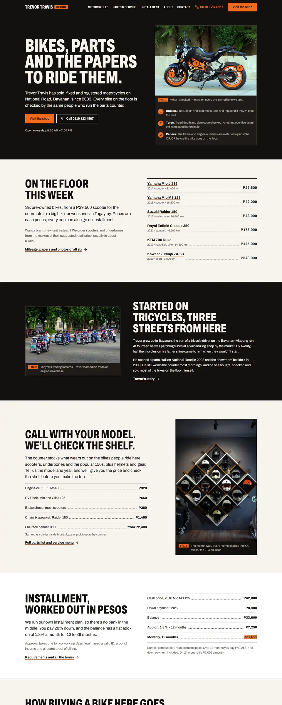
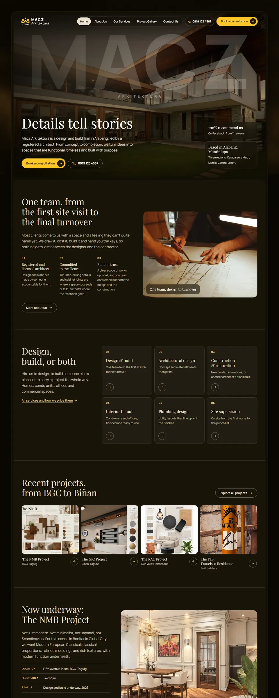
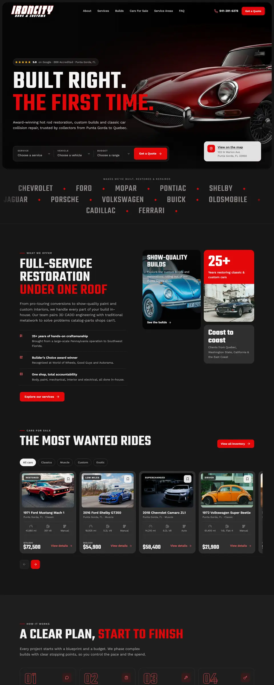
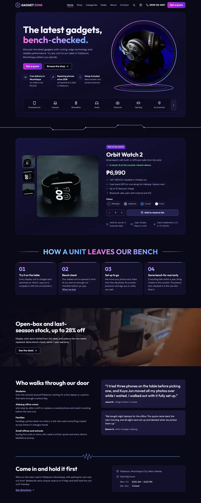

# Website pipeline

A [Claude Code](https://claude.com/claude-code) skill I built to run a small-business website from a short brief to a tested, deployed preview. It covers the brief, design direction, copy and images, the build, automated QA and deployment, and only stops to ask about things it can't decide on its own: facts only the client can confirm, real inboxes, production deploys and spending.

Most of the concept sites in my [portfolio](https://ernestbanigon.pages.dev) were built with it, and so was the portfolio itself ([source](https://github.com/Irnist/portfolio)).

| | |
|---|---|
|  |  |
|  |  |

## How a site gets made

You fill in a short brief (or type one line: name, town, phone, website), drop the client's photos in a folder and run `/website`. Then it works through seven phases:

| Phase | What happens |
|---|---|
| 1. Intake | Reads the brief, links and photos, catalogues the assets and fills the site's data file. Asks at most one batch of questions. |
| 2. Direction | Builds a visual identity from the business's own story (owner, history, location, real work), using a library of past sites and design patterns, not a category template. |
| 3. Content | Sitemap, copy written from real facts, and an image plan. Stock photos fill the gaps, and no photo appears twice. |
| 4. Build | Homepage first, reviewed, then the remaining pages. Static HTML, CSS and JavaScript from a small Python build script, with optional GSAP motion. |
| 5. QA | Automated checks (below), screenshot review and a design critique, repeated until there are 0 errors (up to three rounds). |
| 6. Deploy | A `noindex` preview on Cloudflare or Netlify, checked to be publicly reachable. |
| 7. Handoff | A summary with the URL, every placeholder still waiting for real content, and the decisions made along the way. |

There are two modes. A **sample** site is a portfolio piece: when the brief is thin it invents a believable business with 555 phone numbers and example.com emails. A **client** site uses facts only, and anything unknown becomes a marked placeholder instead of an invented claim.

## Automated QA

- **`tools/qa.py`** checks the built pages against the rules: repeated photos, leftover placeholders, form selects that start with a pre-chosen answer, one call-to-action label sitewide, tap-to-call on phones, CSS animation (all motion runs in JavaScript), headline line-height, cut-out halos and local SEO (business structured data, unique titles and descriptions, share images, favicon, robots.txt).
- **`tools/browser_qa.mjs`** opens every page in headless Chrome at 360, 390 and 1440px. It checks horizontal overflow, contrast measured against the actual pixels (text on photos and glows included), the hero button staying above the fold, wrapping badges, broken images and text hidden by motion. It also runs axe-core accessibility rules and Lighthouse mobile scores, and saves screenshots.
- **`dev/selftest.py`** keeps the checks honest: it plants every known defect into a copy of a finished site and fails if any check stays quiet, or if the clean copy reports an error.

## Mistakes become checks

When I correct something or QA catches a mistake, it's logged in [`LESSONS.md`](LESSONS.md) with the cause and the fix, then enforced as strongly as possible: an automated check first, otherwise a rule in [`RULES.md`](RULES.md) or a step in [`SKILL.md`](SKILL.md). There are 82 lessons so far, and 56 of them are machine-checked. [`LESSONS-INDEX.md`](LESSONS-INDEX.md) lists them one per line.

## What's in here

| Path | What it is |
|---|---|
| `SKILL.md` | The pipeline itself: the instructions Claude follows for each phase |
| `RULES.md` | Design and build rules learned from past sites |
| `LESSONS.md`, `LESSONS-INDEX.md` | The mistake log and its one-line index |
| `template/` | The starting site copied into every new project: build script, page partials, base CSS and JS, self-hosted GSAP |
| `tools/` | The shared QA, image and deploy tools. Each site's `tools/` folder holds small stubs that run these, so a new check reaches every site at once. |
| `dev/` | Self-test, lessons index generator, and helpers for adding sites and inspiration to the design library |
| `design-library/` | Notes on every past site (layout, palette, type, motion, what worked), a cross-site pattern catalogue and screenshots |
| `brief-form/` | A small local web form for filling in a brief |
| `scaffold.ps1` | Creates or reopens a project folder from the template |

## Running it

It's built for my own setup: Windows, with this folder linked as `~/.claude/skills/website` and the sites in a fixed workspace layout (see the start of `SKILL.md`). You need Claude Code, Python 3 with Pillow and NumPy, Node.js 18 or newer, and Google Chrome. Deploying uses `npx wrangler` or `npx netlify-cli`.
